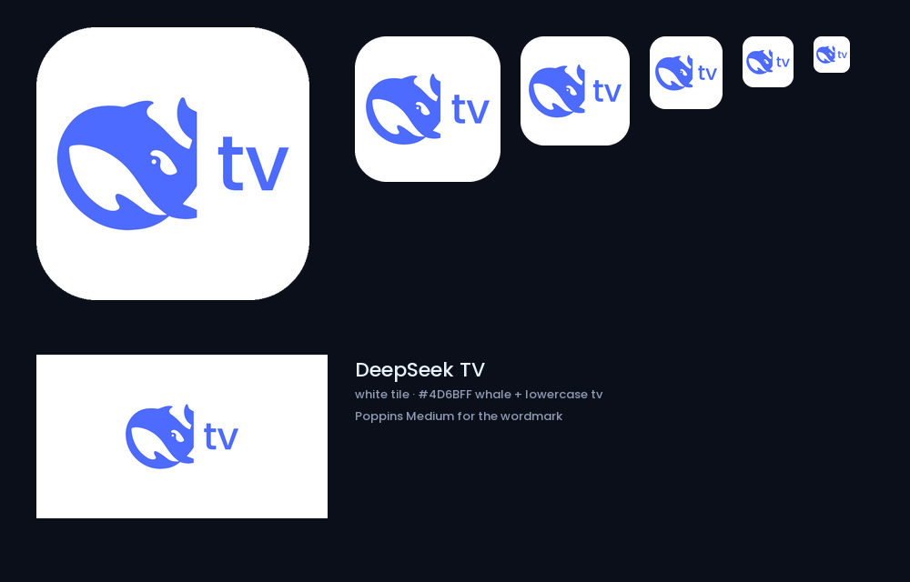
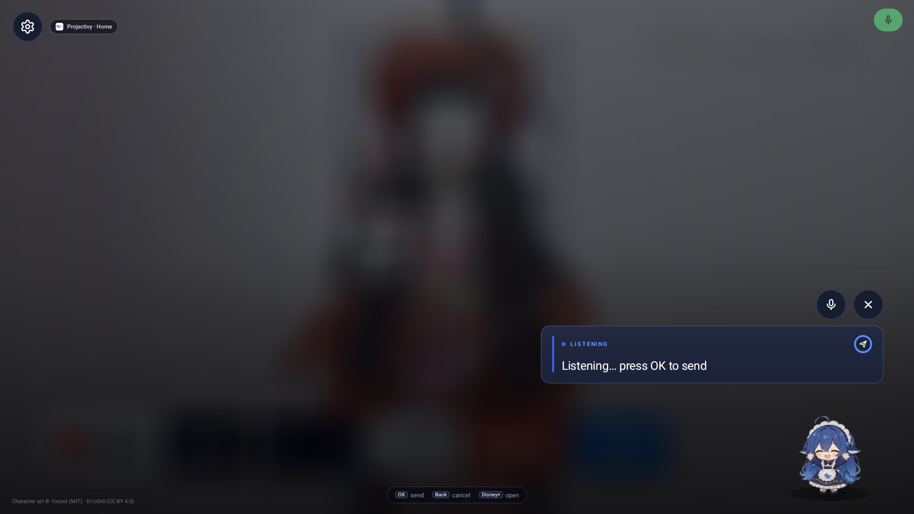
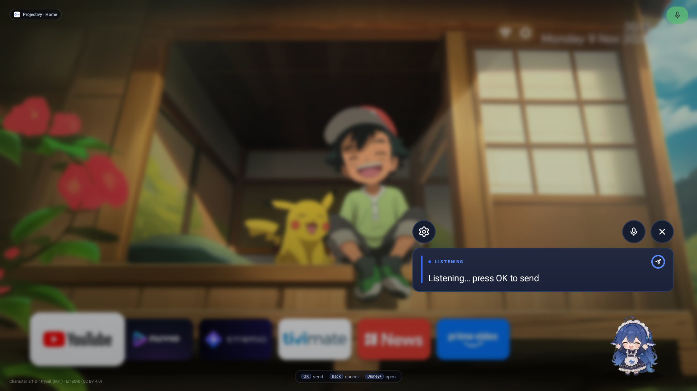
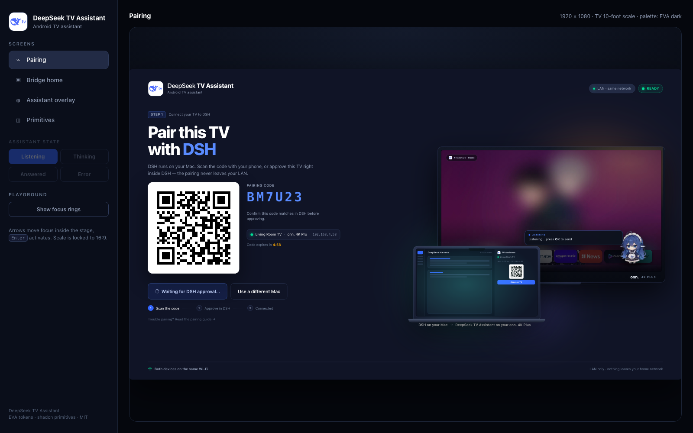

# DeepSeek TV Assistant — design system

The TV app and the DSH pane share one visual language: **Eva Design System
tokens** exposed through **shadcn/ui primitives**. EVA supplies the colour
math and semantic scale; shadcn supplies the component vocabulary and variant
names. Nothing is a one-off colour.

- Eva Design System dark theme — [`@eva-design/eva`](https://github.com/akveo/eva-design) (`dark.json`, UI Kitten)
- shadcn/ui primitives — <https://ui.shadcn.com/docs/components/button>
- Radii/spacing follow shadcn (`--radius: 8px`) scaled up for 10-foot viewing.

## Tokens

shadcn semantic token → EVA token → value (Eva dark theme):

| shadcn | Eva | value | used for |
| --- | --- | --- | --- |
| `background` | `background-basic-color-4` | `#101426` | screen backdrop (gradient to `#0B0F1F`) |
| `foreground` | `text-basic-color` | `#FFFFFF` | primary text |
| `card` | `background-basic-color-2` | `#1A2138` | cards, speech bubble |
| `popover` | `background-basic-color-1` | `#222B45` | raised controls |
| `secondary` | `background-basic-color-1` | `#222B45` | secondary buttons, badges |
| `muted` | `background-basic-color-3` | `#151A30` | inset panels, inputs |
| `muted-foreground` | `text-hint-color` | `#8F9BB3` | captions, descriptions |
| `primary` | `color-primary-500` | `#3366FF` | primary actions, brand accent |
| `primary-hover` / `active` | `primary-400` / `primary-600` | `#598BFF` / `#274BDB` | button states |
| `destructive` | `color-danger-500` | `#FF3D71` | errors, stop/off |
| `success` | `color-success-500` | `#00E096` | running/paired |
| `warning` | `color-warning-500` | `#FFAA00` | degraded states |
| `border` / `input` | `color-basic-700` | `#2E3A59` | 1px borders, input outline |
| `ring` | `color-primary-400` | `#598BFF` | focus ring |

**10-foot scale contract:** the mockup stage is 1920×1080 design px and the
TV app's logical canvas is 960×540dp (`wm size` 1920×1080 @ density 320), so
`dp = design px / 2`, `sp = design px / 2`. Bridge gutters 152px → **76dp**,
pairing gutters 64px → **32dp**, column gaps 34/44px → **17/22dp**, card radius
20px → **10dp**, control height 56px → **28dp** (pairing/bridge buttons),
circle discs 66px → **33dp**, overlay composer 720×? px → **360dp**, focus ring
`2dp`. Sizes are applied with the new tokens in
[`theme_eva.xml`](android/tv-assistant/res/values/theme_eva.xml) (`gutter`,
`gap_col`, `radius_card`, `disc`, `bubble_width`, …).

**Title-safe / overscan (5% rule):** the 1920×1080 framebuffer captures show
nothing clipped, so the "content is cut off on the left" report is display
overscan — projectors and some HDMI paths crop the outer few percent of the
picture. Both full-screen surfaces therefore add a **safe inset on top of the
design gutters**: `safe_inset` 12dp / `safe_inset_v` 8dp for Bridge home
(`bridge_pad_h` 88dp = 76+12, `bridge_pad_v` 35dp = 27+8) and
`pair_safe_inset` 24dp / `pair_safe_inset_v` 24dp for Pairing
(`pairing_pad_h` 56dp = 32+24 = **5.8%** of the canvas width, 44/38dp
vertical). Rule of thumb: any new full-screen surface keeps its content at
least **5% of the 960dp width (48dp)** from every edge — title safe = 5%,
action safe = 10% — or reuses these tokens. Measured on the Pro:
leftmost card edge moved 152px → 176px (+12dp) after the change.

Typography (mockup px / 2): **Hero** 29dp · **H1** 17dp bold · **H2**
10.5dp medium (9dp inside cards) · **Body** 8dp · **Muted** 7dp / 6.75dp ·
**Label** 5.75dp, tracked +0.09em · **Mono** 7dp (addresses, codes) ·
**Pairing code** 22dp mono, tracked +0.15em · overlay eyebrow 5.75dp,
heard line 10dp, say line 12.5dp.

These text sizes are *pixel-locked to the design* and therefore declared in
`dp` rather than `sp`: the TV's system `font_scale` is 0.85, and `sp` would
shrink every screen by 15% versus the 1:1 design renders. The screen does not
follow the system font-size setting by design; contrast and control sizes carry
legibility instead.

Android resources: [`android/tv-assistant/res/values/theme_eva.xml`](android/tv-assistant/res/values/theme_eva.xml).
Web pane: `evaTheme` CSS variables in [`plugin/ui/src/ui.tsx`](plugin/ui/src/ui.tsx).

## App icon

Minimal DeepSeek TV lockup: white tile, the DeepSeek whale, and lowercase
**tv** in Poppins Medium, both in DeepSeek blue `#4D6BFF`. No gradients or
extra artwork. Sizes 512/256/192/128, plus a white 320×180 Leanback banner.
Launcher label: **DeepSeek TV**.

Launcher icon path: `@mipmap/ic_launcher` is an **adaptive icon** (white
background + `@drawable/ic_launcher_fg`). The foreground is a dedicated
432×432 bitmap (4× the 108dp layer) in which the whale+tv lockup is re-composed
centred at ~58% of the canvas, because the accepted 512px tile is a wide lockup
(433×212) that a launcher masking the central 72/108 circle would crop to just
the `tv`. Keep `res/drawable-nodpi/ic_launcher_fg.png` in sync with
`docs/ui-assets/app-icon.png`; the 512px tile stays as the legacy fallback and
the 320×180 Leanback banner (`res/drawable/banner.png`) is unchanged — its mark
is horizontally centred (bbox centre 159.5 of 160) so a centre crop keeps the
whale.

## Colour system (glows)

Bridge home and the pairing scene share a three-glow palette:

| Glow | Hex | Role |
| --- | --- | --- |
| green | `#3DFFA8` | cool accent, bottom-left / left edge |
| magenta | `#FF4FD8` | warm counterpoint, bottom / top-right |
| purple | `#8B5CF6` | bridge between the two, centre / behind the cards |

Bridge home: green left, purple top-right, magenta bottom, over a faint frost
dot lattice — the glass cards pick the colour up through `backdrop-filter`.
Pairing: green under the laptop, magenta over the TV, purple low centre.
Ratio roughly 60 % indigo base / 25 % purple / 10–15 % green + magenta.

## Primitives## Primitives

| Primitive | Variants / states | Notes |
| --- | --- | --- |
| **Button** | `default`, `secondary`, `outline`, `ghost`, `destructive` × default/lg; hover, pressed, focused, disabled | Focused = ring + 3% scale + lift. `default` is reserved for the one primary action per card. |
| **Card** | default only | `card` fill, 1px `border`, 14dp radius, 24dp padding. |
| **Badge** | `secondary`, `success`, `destructive`, `outline` | status chips ("RUNNING", "WAITING"). |
| **Input** | rest, focused, disabled | `muted` fill, `input` border, ring on focus. |
| **Separator** | — | 1px `border`, used inside cards only. |
| **Alert** | default, destructive | inline guidance and errors. |
| **Status dot** | on (success), off (destructive), accent (primary) | always paired with a word, never colour alone. |
| **QR panel** | — | white 8dp-radius plate; quiet zone is part of the design. |
| **Speech bubble** | listening / thinking / transcript / reply / error | 660dp, 3 lines: eyebrow (state) · transcript (muted) · reply (24sp). |
| **Pet** | 6 animated WebP states | transparent, grounded by a soft radial shadow. |

Buttons are drawn with selector drawables (`res/drawable/btn_*.xml`); in the
pane they are a local shadcn `Button` implementation (only `react` is allowed
in a DSH client bundle, so no dependency was added).

## Focus and motion (10-foot rules)

- Every interactive control shows a **visible ring** when focused; focus is the
  only state a remote user has, so it may never rely on hover.
- Focused controls scale **1.03**, lift with elevation, in **120 ms**.
- Initial focus lands on the primary action of the screen.
- No auto-advancing carousels or timed dismissals inside the assistant overlay;
  the overlay closes only after a reply/error timeout or Back.
- The pet's animation carries the "working" state; never animate the whole card.

## Screens

### 1. Bridge home

Layout: **152px side gutters** at 1920 (1616px content column) with a 34px
column gap. Cards are **glass**: translucent navy (`rgba(15,23,40,.40)`),
30px backdrop blur, 20px radius, a light top rim and a diagonal sheen. Behind
the cards sit five soft glows (indigo, teal, amber, violet) plus a faint frost
dot lattice so the glass has something to blur. (`com.jp.dshtv.MainActivity`)

Order: brand → status card (state dot + address/mic/accessibility/foreground)
→ **Get started** (pairing primary, then service controls as secondary/outline)
→ first-time setup steps → LAN note. One primary action per screen.

The service control is one state-coloured toggle (`MainActivity.refreshStatus`):
**green** success-tinted "Start service" (power glyph) while the bridge is
stopped, **red** destructive "Stop service" while it is running; both variants
carry the same 2dp focus ring. Screenshots:
[tv-bridge-home.png](docs/screenshots/tv-bridge-home.png) (running),
[tv-bridge-home-stopped.png](docs/screenshots/tv-bridge-home-stopped.png)
(green start action), [tv-bridge-home-4k-plus.png](docs/screenshots/tv-bridge-home-4k-plus.png)
(updated 1.0→2.0 on the second box).

### 2. Pairing (`PairingActivity`)

Brandbar (lockup + `LAN · same network` pill + `READY/SCANNING/WAITING/PAIRED/ERROR`
badge), then a two-column hero. Left: **STEP 1** chip, 58px hero "Pair this TV
with **DSH**", subline, 318px white QR plate beside the `PAIRING CODE`, device
chip (`● <device_name> · <Build.MODEL> · <IP>`) and expiry countdown, the disabled
"Waiting for DSH approval…" primary with spinner, a dark **Use a different
Mac**, the three-step tracker and the pairing-guide line. Right: the exported
mockup device scene (`res/drawable-nodpi/pair_scene.png` — TV + laptop, glows,
caption). The real address input + `Pair` button are the idle/error state
(hidden while a session is waiting). The QR is the live daemon bitmap; when the
Mac cannot render one the plate shows the approve URL + code instead of going
blank.

### 3. Assistant overlay (`WhaleActivity` / voice session)

A translucent window over the playing app, presented as a **modal**. The
composer is a 360dp card (2dp state rule + eyebrow + transcript + reply) above
the animated pet, with the 32dp round **mic** and **close** controls above it.
The **settings gear** lives in a top-left cluster directly beside the app chip
(same 32dp disc + focus ring; Lucide `settings` drawn *outlined* — 24×24
viewport, 2px round stroke, no fill), and leaves the assistant for the Bridge
home. D-pad contract (explicit `nextFocus*` ids + `WhaleUi.handleDpad`): Send
LEFT → gear, Send UP → mic; gear RIGHT/UP → mic, gear DOWN → Send; mic LEFT →
gear; close LEFT → mic. Initial focus stays on the composer Send while
listening. States:

| State | Eyebrow | Dot | Pet | Body |
| --- | --- | --- | --- | --- |
| listening | `LISTENING` | primary | wave | "Listening… press OK to send" |
| thinking | `THINKING` | primary | think → busy | "DSH is working on it…" |
| heard | `WHALE-CHAN` | primary | think | `“transcript”` |
| answered | `WHALE-CHAN` | success | celebrate | reply, then TTS |
| error | `TRY AGAIN` | destructive | wilt | what to do next |

`OK` commits early; `Back` cancels. The credit line stays in the bottom-left.

**Modal presentation** (`OverlayModal` + `WhaleActivity`): a captured backdrop
of the screen behind (accessibility-service `takeScreenshot`, in `KeyService`)
is downscaled to 160px, box-blurred and shown full-screen under a ~66%-black
scrim with a vignette and a bottom gradient; the capture is taken before our
window paints, so the bubble never blurs itself. If capture is unavailable
(API < 30, accessibility off, refused) the strong scrim alone carries the
contrast. Cross-window blur is dead on the demo boxes
(`ro.surface_flinger.supports_background_blur` is empty), so
`WindowManager.isCrossWindowBlurEnabled()` + `setBackgroundBlurRadius` is only a
guarded bonus path. The composer and pet fade+scale in over 150-200ms, and the
app chip names the app actually behind the modal (`KeyService`
`refreshExternalPackage`, e.g. `Stremio` / `Projectivy · Home`).

### System-owned surfaces

These are Android/Google TV screens — we style the entry points only:
accessibility settings (opened from the bridge screen), the microphone
permission dialog, the TV app launcher tiles, and the bridge foreground-service
notification.

## Accessibility

| Pair | Ratio |
| --- | --- |
| foreground / background | 17.1:1 |
| muted-foreground / card | 6.0:1 |
| primary / background | 5.6:1 |
| primary-foreground / primary | 4.6:1 |
| destructive / card | 4.4:1 (large text only) |

- All text ≥12sp; body ≥16sp; controls 56dp tall with 24dp padding.
- Status is always label + dot (never colour alone).
- Assistant state changes call `announceForAccessibility` so TalkBack hears the
  transcript and reply.
- The app only **reads** the enabled accessibility services (to show
  Connected/Enabled/Disabled on the bridge card). It never writes them:
  enabling ours is done by [`host/tv-accessibility.sh`](host/tv-accessibility.sh),
  which appends `com.jp.dshtv/com.jp.dshtv.KeyService` to the existing list and
  never replaces it — a raw `settings put` would disable the user's Projectivy
  and tvQuickActions services.
- QR has a content description; codes are monospace for readability.
- The pane uses native `<button role="radio">` semantics, `aria-live` on
  status, `role="alert"` on errors, and a visible ring on keyboard focus.

## Do / Don't

| Do | Don't |
| --- | --- |
| Use `default` for one action per card | Put three blue buttons in a row |
| Pair every status colour with a word | Use colour as the only signal |
| Keep 24dp card padding, 14dp radius | Mix 8dp and 20dp card corners |
| Use EVA tokens (no raw hex in layouts) | Invent a second accent colour |
| Keep the pet at 300–380dp with a shadow | Stretch the pet to fill the screen |

## Pairing-first visual language

The pairing screen is the reference screen — every other surface borrows its
parts rather than inventing new ones.

The TV grab is a real capture from the onn. 4K Plus (`docs/ui-assets/tv-launcher.webp`),
so the scene stays honest about the launcher, the app row and the Whale-chan tile.

**Anatomy**

- **Brandbar** — 54px brand tile + wordmark (`DeepSeek` regular, `Whale-chan`
  heavy) + tagline; on the right a LAN pill and a state badge. Appears on
  pairing, bridge and (as a small mark) in the assistant bubble.
- **Step chip + hero** — `STEP 1` chip, 58px/800 headline with exactly one
  emphasised word (`DSH`), one-sentence subline.
- **QR block** — white plate (318px, quiet zone built in), pairing code in
  tracked monospace (44px), device chip (`● <device_name> · <Build.MODEL> ·
  <IP>`), expiry in warning amber.
  The device identity is **read from the TV**, not the mockup copy:
  `Settings.Global.device_name` (fallback `Build.MODEL`, then "Android TV") and
  `Build.MODEL`; when the user never named the box the two are equal and only
  one is shown. Observed on the two demo boxes: the Pro reads
  "Living Room TV · onn. Streaming Device 4K pro · 192.168.4.58", the 4K Plus
  reads "onn. 4K Plus Streaming · 192.168.5.205". The Bridge-home
  “Paired with” TV row uses the same `device_name`
  ([DeviceInfo.java](android/tv-assistant/src/com/jp/dshtv/DeviceInfo.java)).
- **Actions** — the waiting state is a *disabled* primary with a spinner; the
  escape hatch (`Use a different Mac`) is outline. One primary per screen.
- **Progress** — a three-step tracker under the actions: Scan → Approve in DSH →
  Connected. The current step uses primary; done uses success.
- **Device scene** — a big **onn. 4K Plus** TV (792px, `onn.` wordmark on the
  chin) sits *behind* a 442px Mac laptop. The TV screen uses a real grab of the
  Projectivy launcher, with Whale-chan and a listening bubble overlaid inside
  the TV. The laptop in front runs DSH, with the Whale-chan TV pane open on
  “Living Room TV · onn. 4K Plus · 192.168.4.58” and an Approve button.
- **Footer** — Wi-Fi icon + “Both devices on the same Wi-Fi” + “LAN only”.

**Derived into the other screens**

| Screen | Borrowed |
| --- | --- |
| Bridge home | brandbar, LAN/state pills, “Paired with” laptop ⇢ TV mini row, connected badge |
| Assistant overlay | same overlay language, but rendered over the same real launcher grab with a `Projectivy · Home` chip; brand mark in the bubble header, whale as the state carrier |
| Primitives | brand lockup + status chips + code/type styles as the shared kit |

**Rules**

- Brand appears once at the top of a screen; never in every card.
- Whale-chan is a character, not wallpaper — one appearance per screen.
- The device scene only appears where the connection is the subject; bridge
  gets the compact row instead.
- Status is always word + dot; codes and addresses always monospace.
- Exactly one primary action per screen.

## Implementation map

| File | Role |
| --- | --- |
| `res/values/theme_eva.xml` | EVA tokens under shadcn names |
| `res/values/styles.xml` | typography + Button/Card primitives |
| `res/drawable/btn_*.xml` | variant states incl. focus ring |
| `res/layout/activity_main.xml` | bridge home |
| `res/layout/pairing.xml` | pairing |
| `res/layout/whale_session.xml` | assistant overlay |
| `plugin/ui/src/ui.tsx` | shadcn primitives for the DSH pane |
| `plugin/ui/src/client.tsx` | pane composition using those primitives |
