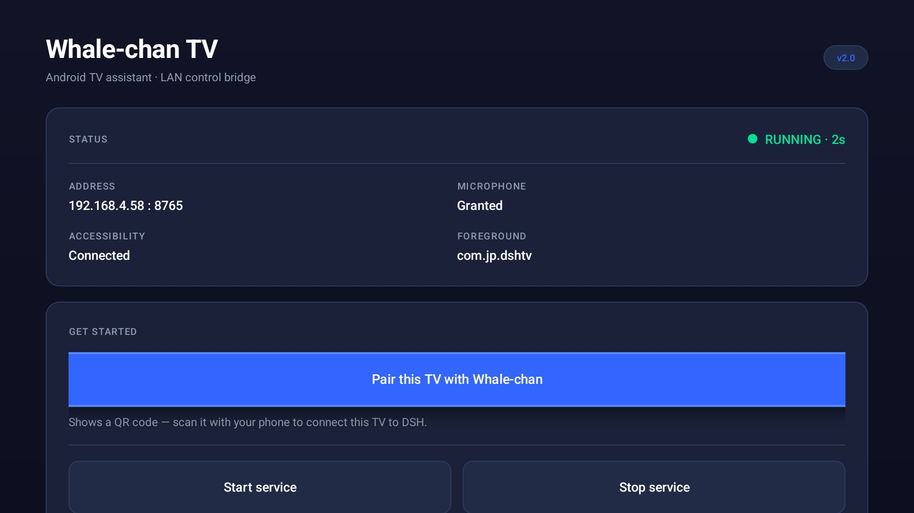
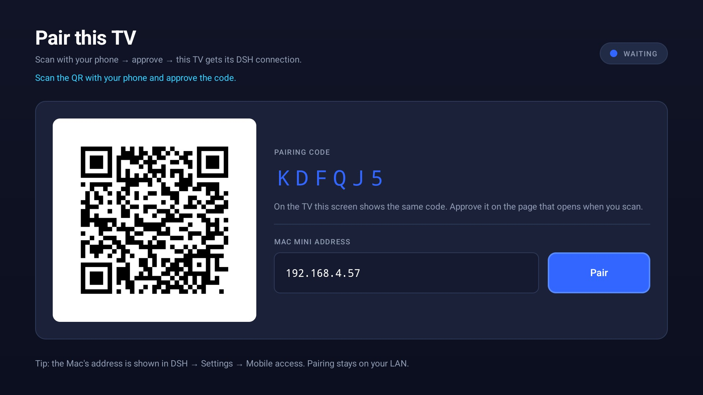
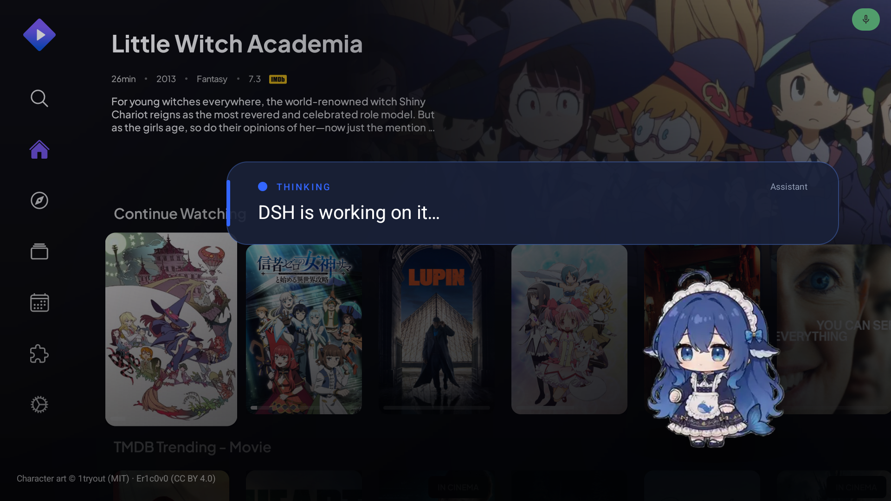
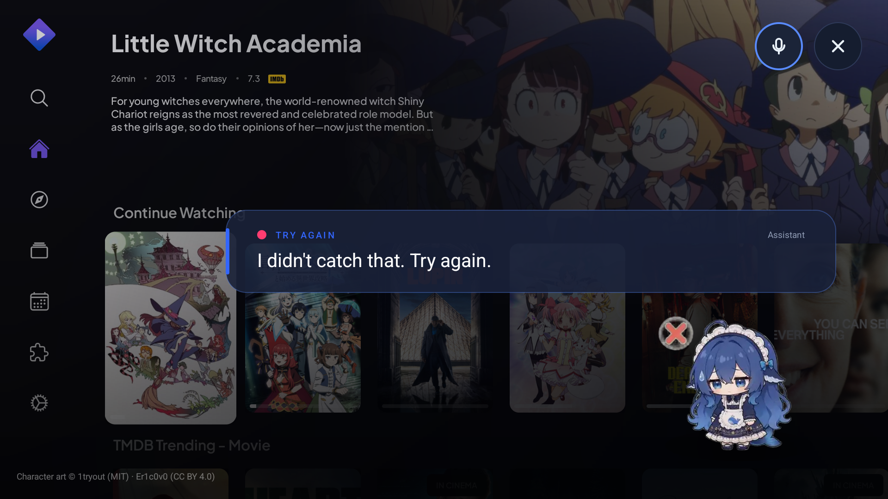

# DeepSeek Whale-chan — Android TV assistant · design system

The TV app and the DSH pane share one visual language: **Eva Design System
tokens** exposed through **shadcn/ui primitives**. EVA supplies the colour
math and semantic scale; shadcn supplies the component vocabulary and variant
names. Nothing is a one-off colour.

- Eva Design System dark theme — [`@eva-design/eva`](https://github.com/akveo/eva-design) (`dark.json`, UI Kitten)
- shadcn/ui primitives — <https://ui.shadcn.com/docs/components/button>
- Radii/spacing follow shadcn (`--radius: 8px`) scaled up for 10-foot viewing.

## Tokens

shadcn semantic token → EVA token → value (Eva dark theme):

| shadcn | Eva | value | used for |
| --- | --- | --- | --- |
| `background` | `background-basic-color-4` | `#101426` | screen backdrop (gradient to `#0B0F1F`) |
| `foreground` | `text-basic-color` | `#FFFFFF` | primary text |
| `card` | `background-basic-color-2` | `#1A2138` | cards, speech bubble |
| `popover` | `background-basic-color-1` | `#222B45` | raised controls |
| `secondary` | `background-basic-color-1` | `#222B45` | secondary buttons, badges |
| `muted` | `background-basic-color-3` | `#151A30` | inset panels, inputs |
| `muted-foreground` | `text-hint-color` | `#8F9BB3` | captions, descriptions |
| `primary` | `color-primary-500` | `#3366FF` | primary actions, brand accent |
| `primary-hover` / `active` | `primary-400` / `primary-600` | `#598BFF` / `#274BDB` | button states |
| `destructive` | `color-danger-500` | `#FF3D71` | errors, stop/off |
| `success` | `color-success-500` | `#00E096` | running/paired |
| `warning` | `color-warning-500` | `#FFAA00` | degraded states |
| `border` / `input` | `color-basic-700` | `#2E3A59` | 1px borders, input outline |
| `ring` | `color-primary-400` | `#598BFF` | focus ring |

Scale: `radius-sm 8dp` (inputs, chips) · `radius-md 10dp` (buttons) ·
`radius-lg 14dp` (cards, bubble) · spacing `4/8/12/16/24/32/48`
· control height `56dp` (TV) · focus ring `2dp`.

Typography (EVA text styles, TV-scaled): **H1** 32sp bold · **H2** 20sp medium
· **Body** 16sp · **BodyMedium** 16sp medium · **Muted** 14sp · **Label**
12sp, tracked +0.08 · **Mono** 14sp (addresses, codes).

Android resources: [`android/tv-assistant/res/values/theme_eva.xml`](android/tv-assistant/res/values/theme_eva.xml).
Web pane: `evaTheme` CSS variables in [`plugin/ui/src/ui.tsx`](plugin/ui/src/ui.tsx).

## Primitives

| Primitive | Variants / states | Notes |
| --- | --- | --- |
| **Button** | `default`, `secondary`, `outline`, `ghost`, `destructive` × default/lg; hover, pressed, focused, disabled | Focused = ring + 3% scale + lift. `default` is reserved for the one primary action per card. |
| **Card** | default only | `card` fill, 1px `border`, 14dp radius, 24dp padding. |
| **Badge** | `secondary`, `success`, `destructive`, `outline` | status chips ("RUNNING", "WAITING"). |
| **Input** | rest, focused, disabled | `muted` fill, `input` border, ring on focus. |
| **Separator** | — | 1px `border`, used inside cards only. |
| **Alert** | default, destructive | inline guidance and errors. |
| **Status dot** | on (success), off (destructive), accent (primary) | always paired with a word, never colour alone. |
| **QR panel** | — | white 8dp-radius plate; quiet zone is part of the design. |
| **Speech bubble** | listening / thinking / transcript / reply / error | 660dp, 3 lines: eyebrow (state) · transcript (muted) · reply (24sp). |
| **Pet** | 6 animated WebP states | transparent, grounded by a soft radial shadow. |

Buttons are drawn with selector drawables (`res/drawable/btn_*.xml`); in the
pane they are a local shadcn `Button` implementation (only `react` is allowed
in a DSH client bundle, so no dependency was added).

## Focus and motion (10-foot rules)

- Every interactive control shows a **visible ring** when focused; focus is the
  only state a remote user has, so it may never rely on hover.
- Focused controls scale **1.03**, lift with elevation, in **120 ms**.
- Initial focus lands on the primary action of the screen.
- No auto-advancing carousels or timed dismissals inside the assistant overlay;
  the overlay closes only after a reply/error timeout or Back.
- The pet's animation carries the "working" state; never animate the whole card.

## Screens

### 1. Bridge home (`com.jp.dshtv.MainActivity`)

Order: brand → status card (state dot + address/mic/accessibility/foreground)
→ **Get started** (pairing primary, then service controls as secondary/outline)
→ first-time setup steps → LAN note. One primary action per screen.

### 2. Pairing (`PairingActivity`)

Left: white QR plate. Right: `PAIRING CODE` label + monospace code, the
"approve on your phone" instruction, separator, **Mac mini address** input and
the `Pair` primary action. A status pill top-right reads `SCANNING`, `WAITING`,
`PAIRED` or `ERROR`; the hint line beneath the title carries the detail.

### 3. Assistant overlay (`WhaleActivity` / voice session)

Transparent window over the playing app. A 660dp bubble (eyebrow + transcript +
reply) sits above the animated pet. States:

| State | Eyebrow | Dot | Pet | Body |
| --- | --- | --- | --- | --- |
| listening | `LISTENING` | primary | wave | "Listening… press OK to send" |
| thinking | `THINKING` | primary | think → busy | "DSH is working on it…" |
| heard | `WHALE-CHAN` | primary | think | `“transcript”` |
| answered | `WHALE-CHAN` | success | celebrate | reply, then TTS |
| error | `TRY AGAIN` | destructive | wilt | what to do next |

`OK` commits early; `Back` cancels. The credit line stays in the bottom-left.

### System-owned surfaces

These are Android/Google TV screens — we style the entry points only:
accessibility settings (opened from the bridge screen), the microphone
permission dialog, the TV app launcher tiles, and the bridge foreground-service
notification.

## Accessibility

| Pair | Ratio |
| --- | --- |
| foreground / background | 17.1:1 |
| muted-foreground / card | 6.0:1 |
| primary / background | 5.6:1 |
| primary-foreground / primary | 4.6:1 |
| destructive / card | 4.4:1 (large text only) |

- All text ≥12sp; body ≥16sp; controls 56dp tall with 24dp padding.
- Status is always label + dot (never colour alone).
- Assistant state changes call `announceForAccessibility` so TalkBack hears the
  transcript and reply.
- QR has a content description; codes are monospace for readability.
- The pane uses native `<button role="radio">` semantics, `aria-live` on
  status, `role="alert"` on errors, and a visible ring on keyboard focus.

## Do / Don't

| Do | Don't |
| --- | --- |
| Use `default` for one action per card | Put three blue buttons in a row |
| Pair every status colour with a word | Use colour as the only signal |
| Keep 24dp card padding, 14dp radius | Mix 8dp and 20dp card corners |
| Use EVA tokens (no raw hex in layouts) | Invent a second accent colour |
| Keep the pet at 300–380dp with a shadow | Stretch the pet to fill the screen |

## Implementation map

| File | Role |
| --- | --- |
| `res/values/theme_eva.xml` | EVA tokens under shadcn names |
| `res/values/styles.xml` | typography + Button/Card primitives |
| `res/drawable/btn_*.xml` | variant states incl. focus ring |
| `res/layout/activity_main.xml` | bridge home |
| `res/layout/pairing.xml` | pairing |
| `res/layout/whale_session.xml` | assistant overlay |
| `plugin/ui/src/ui.tsx` | shadcn primitives for the DSH pane |
| `plugin/ui/src/client.tsx` | pane composition using those primitives |
