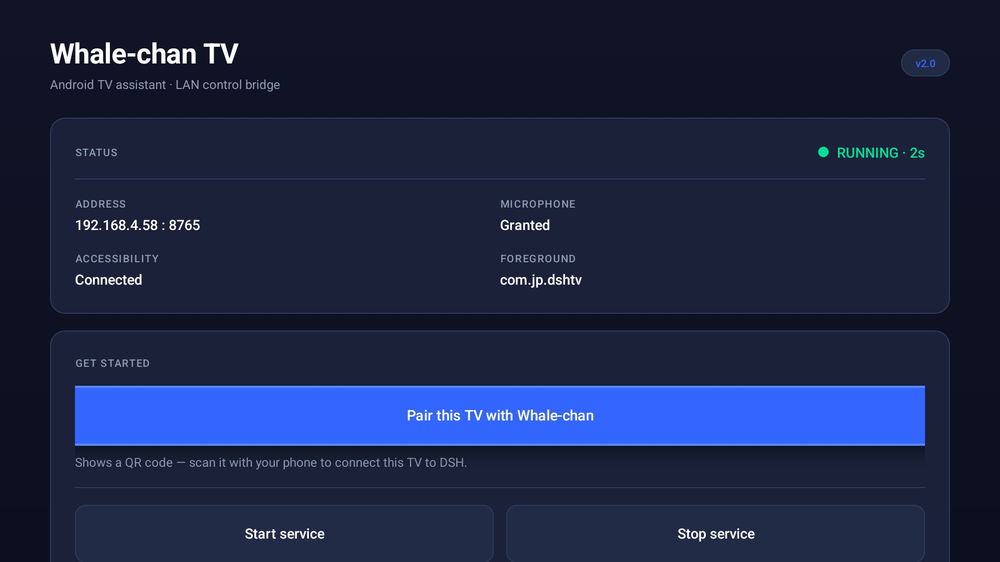
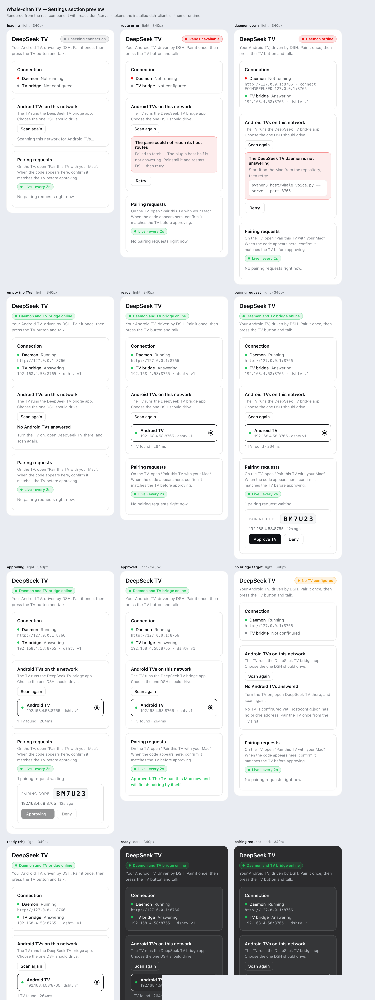

# DeepSeek TV Assistant

`https://github.com/thuyqpham/dsh-tv` · MIT

**Whale-chan** — the animated assistant character — turns an Android TV box into a voice terminal for DeepSeek Harness.


DeepSeek Whale-chan turns an Android TV box into a voice terminal for
[DeepSeek Harness](https://github.com/deepseek-ai/deepseek-harness). Press one
button on the remote, talk, and DSH on your Mac drives the TV — launch any app,
navigate it, search, type — then answers through an animated whale-girl pet.

- **One APK** contains the TV bridge (key injection, app launching, screenshots)
  and the Whale-chan assistant UI.
- **QR pairing** — no IP addresses or tokens typed on a TV remote
  ([design](docs/PAIRING.md)).
- **DSH does the thinking** in a persistent voice session; the TV is a
  microphone, a screen and a remote.
- **DSH's own SenseVoice STT**, or Whisper as a fallback.
- **Full app control**: D-pad/OK/back/home, text entry, screenshots; the agent
  can see the screen and drive apps that have no voice API.
- Works with Google Assistant left intact: the mic button stays Google's, the
  Disney+ button becomes Whale-chan (optional shim).

## How it fits together

```
Android TV box                            Mac mini (or any LAN host)
┌──────────────────────────────┐          ┌────────────────────────────────┐
│ com.jp.dshtv (single APK)    │          │ host/whale_voice.py :8766      │
│  • DSH TV Bridge (accessib.) │          │  • QR pairing endpoints        │
│  • Whale-chan pet + bubble   │  audio   │  • SenseVoice STT              │
│  • mic + VAD, OK to send     │ ───────▶ │  • DSH headless voice session  │
│  • QR pairing screen         │ ◀─────── │  • agent drives the TV via     │
└──────────────────────────────┘  reply   │    host/dshtv.py (bridge CLI)  │
       ▲ Disney+ button                   └────────────────────────────────┘
       └ com.disney.disneyplus shim (optional)
```

## Requirements

- Android TV / Google TV, Android 9+ (tested on the onn. 4K Pro, Android 14).
- A LAN host that stays awake: macOS/Linux with Python 3.10+, Node 22 for the
  SenseVoice runtime, and DSH with a valid model credential.
- Build machine with JDK 8+ and Android SDK build-tools + platform 33.

## Install from a release

Download the latest `TVAssistant.apk` (and optionally `DisneyShim.apk`) from
[Releases](https://github.com/thuyqpham/dsh-tv/releases), then:

```bash
adb connect <tv-ip>:5555
adb install -r -g TVAssistant.apk
adb shell pm grant com.jp.dshtv android.permission.RECORD_AUDIO
# enable the bridge accessibility service once in the TV's settings
```

The release APK is debug-signed and baked with `WHALE_TOKEN=pair-me`; the QR
pairing replaces that placeholder with the real token. Build from source for your
own signing key (see below).

## Quick start

### 1. Host

```bash
python3 -m venv .venv && . .venv/bin/activate
pip install "qrcode[pil]"                     # QR pairing images
mkdir -p .auth
python3 -c 'import secrets;print("".join(secrets.choice("abcdefghjkmnpqrstuvwxyz23456789") for _ in range(10)))' > .auth/whale.token
printf '%s' 'sk-your-deepseek-key' > .auth/deepseek.key   # for `dsh headless`
chmod 600 .auth/*
python3 host/whale_voice.py --serve --port 8766
```

The daemon keeps one persistent DSH session (`--session-id`) so context carries
between utterances. `host/dsh_stt.mjs` uses the SenseVoice ONNX model that DSH
already caches (`~/.dsh/speech-to-text/sensevoice/models`); install
`sherpa-onnx-node` into `host/` if it is not resolvable:

```bash
cd host && npm install sherpa-onnx-node@1.13.8
```

### 2. TV

```bash
ANDROID_SDK_ROOT=/path/to/android-sdk bash android/tv-assistant/build.sh
adb connect <tv-ip>:5555
adb install -r -g android/tv-assistant/TVAssistant.apk
adb shell settings put secure enabled_accessibility_services \
  com.jp.osdtrigger/com.jp.osdtrigger.KeyForwardService:dev.vodik7.tvquickactions/dev.vodik7.tvquickactions.KeyAccessibilityService:com.jp.dshtv/com.jp.dshtv.KeyService
adb shell settings put secure accessibility_enabled 1
adb shell pm grant com.jp.dshtv android.permission.RECORD_AUDIO
```

Open the **Pair this TV with Whale-chan** tile on the TV and scan the QR with
your phone; approve the code on the page. The TV stores the Mac's address and
token and opens the assistant. See [docs/PAIRING.md](docs/PAIRING.md).

### 3. The Disney+ button (optional)

Google Assistant keeps the mic button. To get a dedicated Whale-chan button,
install the shim at the package name the vendor remote service launches
(`com.disney.disneyplus`) and make sure the real Disney+ app is not installed:

```bash
bash android/disney-shim/build.sh
adb install -r -g android/disney-shim/DisneyShim.apk
```

The remote's Disney+ button then opens Whale-chan; the mic button stays Google's.

### 4. DSH plugin (optional)

```bash
./plugin/install.sh desktop     # writes an mcp-whale-chan row into the profile patch
```

Restart DSH and you get `whale_health`, `whale_ask` and `whale_start` tools; the
daemon is started on demand.

## UI playground

Open [`docs/ui-mockup.html`](docs/ui-mockup.html) in a browser — it is fully self-contained (all images inlined as data URIs, no asset folder needed): every screen at
1920×1080 with the real EVA tokens, the animated pet and all assistant states.
Use the sidebar (or `#bridge`, `#pairing`, `#assistant`, `#components`) and the
"Show focus rings" toggle to review focus treatment.

## Design system

Every screen follows **EVA design tokens exposed as shadcn/ui primitives**
(Button variants, Card, Badge, Input, Separator, Alert) — tokens, component
states, screen specs and the accessibility contract are in
[DESIGN.md](DESIGN.md).



## Settings pane (plugin UI)

`plugin/ui/` is a DSH client plugin with a settings section shaped like
*Mobile access*: it scans the LAN for TVs, selects one, and generates the pairing
QR. Host routes proxy the daemon so the browser never sees the token.



Build and render a preview:

```bash
cd plugin/ui && npm install && node build.mjs && node tools/preview.mjs
```

See [plugin/ui/README.md](plugin/ui/README.md) for the install seam.

## Using it

1. Press the Whale-chan button (Disney+ shim) or open the assistant tile.
2. The whale animates; say e.g. *"Open Stremio and search for anime."*
3. The bubble shows what it heard (SenseVoice), then DSH's reply, spoken via TTS.
4. **OK** sends early instead of waiting for the silence timeout; **Back** cancels.

## Configuration

| Env | Default | Meaning |
| --- | --- | --- |
| `WHALE_PORT` | 8766 | daemon HTTP port (QR/pair/TV use it) |
| `WHALE_TOKEN` / `.auth/whale.token` | generated | LAN bearer token |
| `WHALE_HOST` (build) | 192.168.4.57 | default host shown on the pairing screen |
| `DSH_STT_LANGUAGE` | auto | SenseVoice language |
| `WHALE_DAEMON_URL` | http://127.0.0.1:8766 | MCP plugin target |
| `DSHTV_CONFIG` / `DSHTV_ADB` | `host/config.json` / PATH | bridge CLI |

## Security

- Audio never leaves the LAN: STT is local, only text goes to the model.
- The TV talks to the daemon with a bearer token; pairing is a one-time code
  valid for 5 minutes and only on the local network.
- Keep ports 8765/8766 on the LAN. Do not expose them to the internet.

## Credits

Artwork and animation: [1tryout/dsh-whale-pixel-pet](https://github.com/1tryout/dsh-whale-pixel-pet)
(MIT) and [Er1c0v0/dsh-whale-pet](https://github.com/Er1c0v0/dsh-whale-pet)
(CC BY 4.0). STT: SenseVoiceSmall via sherpa-onnx (Apache-2.0), Whisper fallback
via mlx-whisper. See [THIRD-PARTY.md](THIRD-PARTY.md).

MIT licensed — see [LICENSE](LICENSE).

## Roadmap

- mDNS discovery so the pairing screen can find the host without typing an IP.
- Per-TV tokens with revocation in the plugin.
- Background/wake-word mode and multilingual STT.
- A DSH marketplace client pane (status + pairing) using the plugin slot API.
