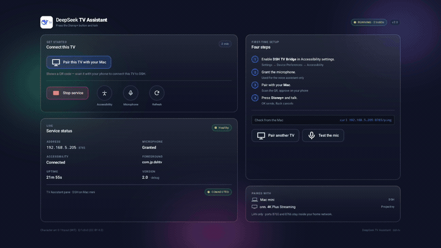
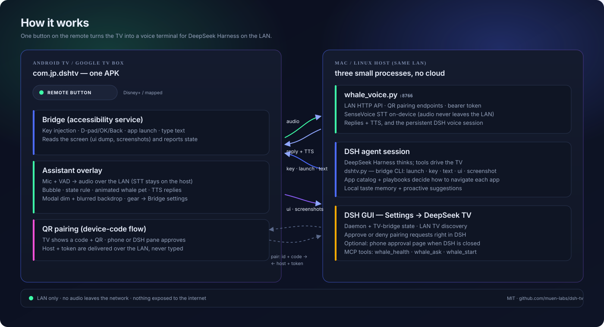
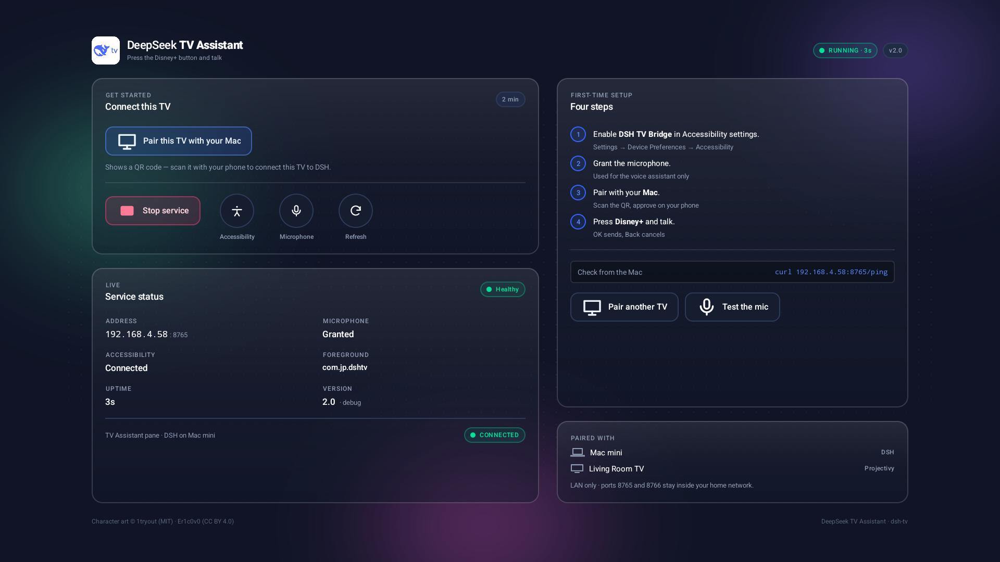
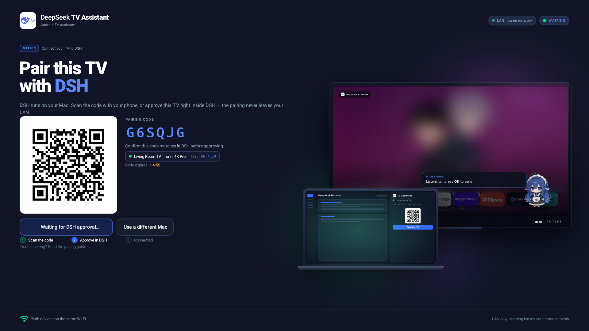
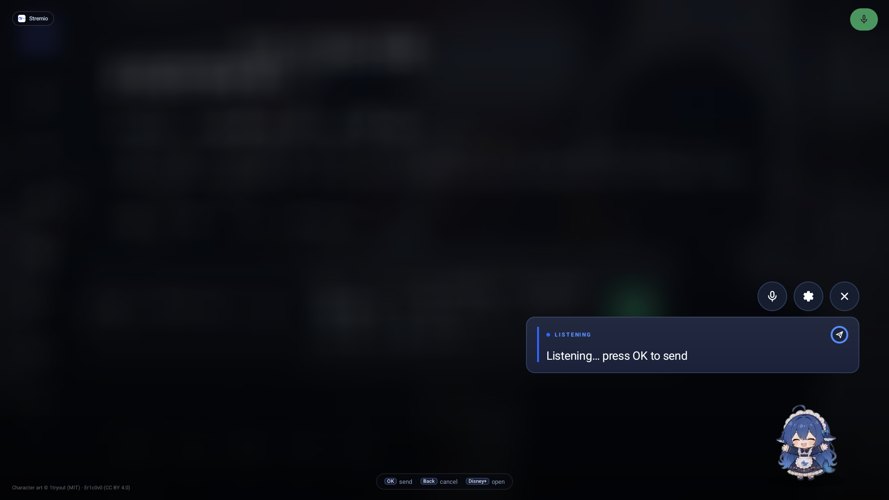
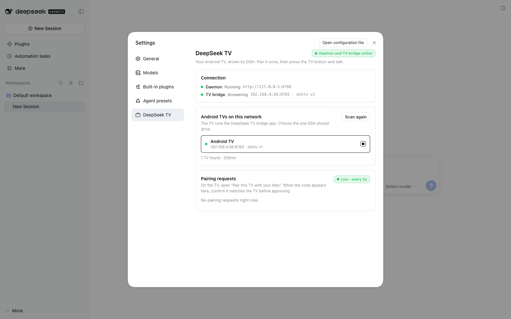

# DeepSeek TV Assistant

**Press one button on your Android TV remote, talk, and DeepSeek Harness on your
Mac drives the TV** — launches apps, navigates, searches, types, reads the screen —
and answers through an animated whale-girl pet. Over the LAN. No cloud in the audio path.

[](https://github.com/muen-labs/dsh-tv/actions/workflows/build-apk.yml)
[](LICENSE)
[](#requirements)
[](#security)
[](#project-status)

**Demo** — a real capture on the onn. 4K Plus: Bridge home → QR pairing → the
assistant modal over Stremio.



[▶ Watch the MP4](docs/demo.mp4) · [every screen in the UI gallery](docs/ui-gallery.html)

One APK contains the **TV bridge** (accessibility key injection, app launch,
screenshots) and the **Whale-chan assistant UI**. A small daemon on the Mac keeps a
persistent [DSH](https://github.com/deepseek-ai/deepseek-harness) voice session and
does the thinking; the TV is the microphone, the screen and the remote.

> **Status:** working on two boxes (onn. 4K Pro and onn. 4K Plus, Android 14) —
> UI, pairing, voice, and full app control are dogfooded. The demo's playback leg
> (Stremio catalog/search matching + stream health) is still being hardened, and a
> wider device matrix is the main thing this project needs. See
> [open issues](https://github.com/muen-labs/dsh-tv/issues).
>
> Also from this account: **[Projector OSD](https://github.com/muen-labs/projector-osd)**
> — put an Android projector's picture menu on the same TV remote.

## Features

- **One APK** — the bridge (key injection, launch, screenshots, screen dumps) and
  the assistant UI; nothing else to install on the TV.
- **QR pairing** — no IP or token typed with a remote. The TV shows a code; a phone
  or the **DSH settings pane** approves it, and the host address/token arrive over
  the LAN.
- **DSH does the thinking** — one persistent voice session, persistent context,
  the agent drives apps through a bridge CLI.
- **Local STT** — DSH's SenseVoice runs on the host; audio never leaves your LAN,
  only text reaches the model. Whisper is a fallback.
- **Full app control** — D-pad/OK/Back/Home, text entry, screenshots and UI dumps
  let the agent drive apps that have no voice API.
- **Assistant as a modal** — dim + soft blur of the app behind (real captured
  backdrop on boxes without system blur), state rule, animated pet, TTS replies.
- **A real DSH plugin** — Settings → **DeepSeek TV**: daemon/TV-bridge health, LAN
  discovery, and Approve/Deny for pairing requests inside DSH.
- **Google Assistant intact** — the mic button stays Google's; the Disney+ button
  becomes Whale-chan via an optional shim.
- **MIT** — fork it, port it, ship it.

## How it works



1. **Listen.** The assistant overlay records a phrase, detects the end of speech
   and sends the audio to `whale_voice.py` on the host (LAN bearer token).
2. **Transcribe & think.** SenseVoice transcribes locally, the text goes into one
   persistent DSH session, and the agent decides what to do — it can call the
   bridge CLI (`dshtv.py`) to launch apps, move the D-pad, type or read the screen.
3. **Drive the TV.** Commands land on `com.jp.dshtv`'s accessibility service, which
   injects keys into the focused app; screenshots/UI dumps come back so the agent
   can verify where it is.
4. **Answer.** The reply is spoken via TTS and drawn in the bubble + pet; the modal
   closes on reply timeout or Back.

Pairing is the same LAN path: the TV asks the daemon for a one-time code, shows it
as a QR, and either a phone or the DSH pane approves it; the host address and
token are then delivered to the TV.

## Requirements

| Requirement | Notes |
| --- | --- |
| **Android TV / Google TV box**, Android 9+ (API 26+) | tested on onn. 4K Pro / 4K Plus, Android 14 |
| **A LAN host that stays awake** | macOS or Linux, Python 3.10+, Node 22 for the SenseVoice runtime |
| **DeepSeek Harness with a model credential** | the host daemon starts one headless DSH session |
| **Sideloading** | the APK is debug-signed for now |

| Your setup | Works? |
| --- | --- |
| onn. 4K Pro / 4K Plus (Android 14) + macOS host | ✅ tested |
| Other Android TV / Google TV boxes (Android 9+) | 🟡 expected — the bridge is generic accessibility + intents; UI at 960dp/1080p |
| Fire TV | 🟡 likely but untested (no Google Assistant button story) |
| Apple TV / Roku / webOS / Tizen | ❌ different platforms, no accessibility bridge |
| No host on the same LAN | ❌ the TV cannot do the thinking itself |

## Quick start

### 1. Host

```bash
python3 -m venv .venv && . .venv/bin/activate
pip install "qrcode[pil]"                     # QR images (optional: URL fallback)
mkdir -p .auth
python3 -c 'import secrets;print("".join(secrets.choice("abcdefghjkmnpqrstuvwxyz23456789") for _ in range(10)))' > .auth/whale.token
printf '%s' 'sk-your-deepseek-key' > .auth/deepseek.key
chmod 600 .auth/*
python3 host/whale_voice.py --serve --port 8766
```

The daemon keeps one persistent DSH session so context carries between utterances.
STT uses the SenseVoice ONNX model DSH already caches
(`~/.dsh/speech-to-text/sensevoice/models`); if `sherpa-onnx-node` is not
resolvable from `host/`:

```bash
cd host && npm install sherpa-onnx-node@1.13.8
```

### 2. TV

```bash
ANDROID_SDK_ROOT=/path/to/android-sdk bash android/tv-assistant/build.sh
adb connect <tv-ip>:5555
adb install -r -g android/tv-assistant/TVAssistant.apk
adb shell pm grant com.jp.dshtv android.permission.RECORD_AUDIO
# append ONLY our service — never replace the enabled-services list:
bash host/tv-accessibility.sh <tv-ip>:5555
```

Or grab `TVAssistant.apk` from
[Releases](https://github.com/muen-labs/dsh-tv/releases/latest) (debug-signed,
placeholder token `pair-me` — pairing replaces it).

> **Never** run `settings put secure enabled_accessibility_services <one component>`.
> That replaces the whole list and silently disables the user's Projectivy /
> tvQuickActions services. `host/tv-accessibility.sh` reads the list, appends
> `com.jp.dshtv/com.jp.dshtv.KeyService` if missing, and only prunes packages that
> are no longer installed. If entries keep vanishing, check the vendor **Projector
> OSD app (`com.jp.osdtrigger`)** — it rewrites the list on these boxes. This APK
> never writes it (it only reads).

### 3. Pair

Open the **Pair this TV with your Mac** tile on the TV, then scan the QR with your
phone **or** approve the same request in DSH → Settings → **DeepSeek TV**. The TV
stores the host and token and opens the assistant. See
[docs/PAIRING.md](docs/PAIRING.md).

### 4. DSH plugins (optional but recommended)

```bash
./plugin/install.sh desktop      # MCP tools: whale_health, whale_ask, whale_start
./plugin/install-ui.sh desktop   # Settings -> "DeepSeek TV" pane
```

Restart DSH. The MCP half lets you drive the same voice session from DSH; the
client half adds the settings pane (status, TV discovery, pairing approval).
`install-ui.sh --copy` installs a copy instead of a symlink.

### 5. The Disney+ button (optional)

Google Assistant keeps the mic button. To get a dedicated whale button, install the
shim at the package the vendor remote service launches and make sure the real
Disney+ app is absent:

```bash
bash android/disney-shim/build.sh
adb install -r -g android/disney-shim/DisneyShim.apk
```

## Screens

| | |
| --- | --- |
| **Bridge home** — live state, green Start-service action, setup steps<br> | **Pairing** — real daemon QR, code, tracker, device scene<br> |
| **Assistant modal** — dim + blur, pet, state bubble, gear<br> | **DSH pane** — state, TVs, Approve/Deny inside DSH<br> |

Every implemented screen and state is in the self-contained
[`docs/ui-gallery.html`](docs/ui-gallery.html) (real 1920×1080 captures,
←/→ navigation). The design source is
[`docs/ui-mockup.html`](docs/ui-mockup.html).

## Using it

1. Press the whale button (Disney+ shim) or open the assistant tile.
2. Say e.g. *“Open Stremio and search for anime.”*
3. The bubble shows what it heard, then DSH's reply, spoken via TTS.
4. **OK** sends early instead of waiting for the silence timeout; **Back** cancels.
5. The **gear** (left end of the row above the composer) opens the Bridge/settings
   screen. D-pad: from the composer **LEFT** → gear, **UP** → mic; from the gear
   **RIGHT/UP** → mic, **DOWN** → composer.

**Map a remote button** (optional): tvQuickActions or Button Mapper → *Launch app* →
**DeepSeek TV** (`com.jp.dshtv/.MainActivity` = the Bridge home with pairing and
status). Google TV's launcher tile opens the same screen.

## DSH settings pane

`plugin/ui/` is a DSH client plugin with a **DeepSeek TV** section in the host's own
theme and language. It shows an honest split of *daemon* and *TV bridge* state,
lists the TVs it finds on the LAN (configured target + bounded sweep), and polls for
pairing requests every two seconds: code, source address, age, **Approve / Deny**.
Same-origin `/whale-chan/*` host routes proxy the daemon, so the browser never sees
the token.

```bash
cd plugin/ui && npm ci && node build.mjs && node tools/preview.mjs --png
node tools/verify.mjs && node tools/verify-host.mjs
```


## Voice pipeline, apps & personalisation

- [`docs/VOICE-STT.md`](docs/VOICE-STT.md) — warm SenseVoice worker (0.05–0.08 s per
  utterance), app-name repair, and why the daemon runs outside the agent sandbox.
- [`docs/APP-KNOWLEDGE.md`](docs/APP-KNOWLEDGE.md) — app catalog, per-app playbooks,
  `dshtv ui`, and how DSH decides to navigate each app.
- [`docs/PERSONALIZATION.md`](docs/PERSONALIZATION.md) — local taste memory and the
  proactive suggestion pipeline.
- [`docs/DEMO.md`](docs/DEMO.md) — the K-drama demo script and current status.

## Tested setups

| TV box | Android | Host | Works |
| --- | --- | --- | --- |
| onn. 4K Pro Streaming | 14 | macOS (DSH) | ✅ UI, pairing, voice, app control |
| onn. 4K Plus Streaming | 14 | macOS (DSH) | ✅ same, different subnet |

Compatibility reports are welcome — see
[issue #2](https://github.com/muen-labs/dsh-tv/issues/2) for the matrix.

## Troubleshooting

| Symptom | Cause / fix |
| --- | --- |
| TV says *Could not reach the Mac* | daemon not running, host IP changed, or TV/phone on another VLAN. Start `host/whale_voice.py --serve`, check the address on the pairing screen. |
| Pairing request never appears in DSH | the DSH pane polls every 2 s; check *Daemon online* and the token file. Approval also works from the phone page. |
| *Accessibility: Disabled* on Bridge home | the last reinstall disabled the service. Use the Accessibility button + `host/tv-accessibility.sh` — never replace the list. |
| Assistant hears nothing / *TRY AGAIN* | microphone permission missing, or the daemon/STT failed; check `host/whale_voice.py` logs. |
| Keys don't reach the app | the bridge accessibility service must be enabled; some vendor overlays grab input — check *Accessibility: Connected*. |
| Demo playback stops at *Ow! That stings!* | known stream-health gap ([issue #1](https://github.com/muen-labs/dsh-tv/issues/1)). |
| Remote button opens the wrong app | re-map it (tvQuickActions/Button Mapper) to `com.jp.dshtv/.MainActivity`; reinstall the Disney shim only if the real Disney+ app is absent. |

Debug:

```bash
adb logcat -s DshtvBridge WhalePairing WhaleOverlay
```

## Build from source

No Gradle: `build.sh` is `aapt2 → javac → d8 → zipalign → apksigner`.

```bash
export ANDROID_SDK_ROOT=/path/to/android-sdk   # build-tools + platform 33
export JAVA_HOME=/path/to/jdk                  # JDK 8+
bash android/tv-assistant/build.sh             # needs WHALE_TOKEN or .auth/whale.token
bash android/disney-shim/build.sh
```

The DSH plugin has its own build (`cd plugin/ui && npm ci && node build.mjs`); CI
runs `node tools/verify.mjs` on every push.

## Architecture

| Path | Purpose |
| --- | --- |
| `android/tv-assistant/` | the single APK: bridge accessibility service, assistant overlay, pairing, Bridge home |
| `host/whale_voice.py` | LAN daemon: pairing, STT, persistent DSH voice session, TTS |
| `host/dshtv.py` | bridge CLI (`launch`, `key`, `text`, `ui`, `screenshot`, `state`) |
| `host/demo_kdrama.py` | end-to-end demo runner (research → recommend → play) |
| `host/tv-accessibility.sh` | append-only accessibility helper (never clobbers other services) |
| `plugin/` | MCP tools + DSH client pane (host proxy + settings section) |
| `docs/` | pairing design, STT notes, app knowledge, UI gallery + mockup, screenshots |
| `skills/android-tv/` | reusable DSH/agent skill for Android TV work |
| `DESIGN.md` | EVA/shadcn token map, screen specs, focus and 10-foot rules |

## QA / automation hooks

The overlay and Bridge home accept intent extras, so captures and states can be
driven over adb without touching the remote:

| Extra (on `com.jp.dshtv/.WhaleActivity`) | Effect |
| --- | --- |
| `--ez demo true` | replay a completed exchange (answered state) |
| `--ez thinking true` | render the THINKING state |
| `--ez suggest true --es suggest_title … --es suggest_reason …` | render the FOR YOU suggestion card |

| Extra (on `com.jp.dshtv/.MainActivity`) | Effect |
| --- | --- |
| `--es set_token …` / `--ez clear_token true` | set/clear the bridge token |
| `--es set_port 8765` | change the bridge port |
| `--ez start_service true` | start the bridge foreground service |

```bash
adb shell am start -n com.jp.dshtv/.WhaleActivity --ez thinking true
adb shell am start -n com.jp.dshtv/.WhaleActivity --ez demo true
```

Accessibility key filtering only sees **hardware** key events, so
`adb shell input keyevent` cannot exercise the bridge's forwarding — use the
physical remote for that. Discovery, pairing, launch/text, panel states and the
overlay are testable over adb.

## Security

- Audio never leaves the LAN: STT is local; only text goes to the model.
- The TV talks to the daemon with a bearer token over the LAN; pairing is a
  one-time code valid for 5 minutes and only usable on the local network.
- Keep ports 8765/8766 inside your home network. Never forward them to the internet.
- The APK requests only network + microphone + accessibility access; no credentials
  are stored on the TV beyond the paired host/token.

## Project status

Working and dogfooded on two onn. boxes. The most useful contributions right now:

- [ ] **Compatibility reports** — TV box model, Android version, what worked
      ([issue #2](https://github.com/muen-labs/dsh-tv/issues/2)).
- [ ] **Demo playback leg** — Stremio catalog/search matching + stream health
      ([issue #1](https://github.com/muen-labs/dsh-tv/issues/1)).
- [ ] **Agent skills** — finish the reusable `android-tv` skill and add a
      voice/overlay skill ([issue #3](https://github.com/muen-labs/dsh-tv/issues/3)).
- [ ] **More UI/overscan testing** on 720p and 4K-native boxes.
- [ ] Per-TV tokens with revocation, mDNS host discovery, wake-word mode.

See the [roadmap](#roadmap) below and the
[issues](https://github.com/muen-labs/dsh-tv/issues).

## Contributing

Yes, please — see [CONTRIBUTING.md](CONTRIBUTING.md). The highest-value things are
compatibility reports, the demo's catalog/stream matching, and playbook entries for
apps you actually use. Bug reports with a `logcat` excerpt and a screen recording
are ideal.

## Support the project

DeepSeek TV Assistant is free, MIT and developed in the open. If it saved you a trip
to the remote, you can buy me a coffee — that goes through Ko-fi (the same page as
Projector OSD):

[](https://ko-fi.com/muenlabs)

## Credits

Artwork and animation: [1tryout/dsh-whale-pixel-pet](https://github.com/1tryout/dsh-whale-pixel-pet)
(MIT) and [Er1c0v0/dsh-whale-pet](https://github.com/Er1c0v0/dsh-whale-pet) (CC BY 4.0).
STT: SenseVoiceSmall via sherpa-onnx (Apache-2.0), Whisper fallback via
mlx-whisper. See [THIRD-PARTY.md](THIRD-PARTY.md).

MIT — see [LICENSE](LICENSE).

## Roadmap

- mDNS host discovery so the pairing screen can find the Mac without an address.
- Per-TV tokens with revocation in the plugin (the pane already sees each TV).
- Background/wake-word mode and multilingual STT.
- A DSH marketplace listing for the pane (`dsh plugin --profile <p> add`).
