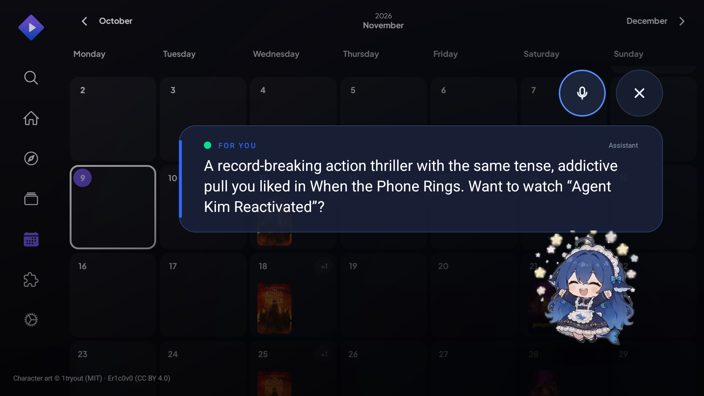

# Personalisation & proactive suggestions

Google Assistant is request/response and scripted. DeepSeek TV Assistant is a DSH
agent with local memory; it should progressively learn this household and earn
the right to suggest things ("there's a new K-drama everyone's talking about").

## Signals we record (local only)

`host/tv_memory.py` → `host/tv-memory.db` (SQLite, never leaves the Mac).

| Signal | Source | Example |
| --- | --- | --- |
| Commands | daemon `/ask`, `/stt`, `/voice` | "put on a K-drama" |
| App usage | command/app context, launches | stremio ×12, tivimate ×4 |
| Explicit feedback | `/feedback`, "not interested" | like *When the Phone Rings* |
| Viewing events | assistant logs a play/watch action | watched 2 episodes |
| Time of day | event timestamps | evenings, weekends |

`summary()` derives top apps, recurring topics (keyword counts), recent requests,
likes and avoid-list; `taste_text()` is the compact paragraph injected into every
DSH prompt, so the agent reasons with habits instead of hard-coded intents.

## Taste model

- **Topics** – keyword frequency over 30 days, stop-words removed.
- **Affinity** – explicit likes / dislikes outrank inferred topics.
- **Recency** – 30-day window with newest events weighted by order.
- **Avoid** – `not_interested`/`dislike` never resurface for 30 days.
- **Services** – installed apps decide where a title can be played (Netflix,
  Prime, Stremio, YouTube); `app` field on a suggestion is the launch target.

## Suggestion pipeline

1. **Trigger** – an explicit "what should I watch?", or ambient (TV idle on home,
   first interaction of the evening). Frequency caps: max 1 ambient / day, quiet
   hours respected.
2. **Candidate search** – `host/suggest.py` queries DeepSeek Search with the topic
   angle + date (e.g. "new K-drama people are talking about on Reddit this week").
3. **Rank & select** – DeepSeek chat receives the taste paragraph + top results,
   returns exactly one `{title, reason, source, app, query}` JSON in the user's
   voice ("the tense, addictive pull you liked in …").
4. **Dedupe** – the same title is suppressed for 7 days (`add_suggestion`).
5. **Surface** – one card/bubble, never a wall of rows. Overlay state `FOR YOU`
   shows reason + "Want to watch X?" with the usual mic / close / focus model.
6. **Feedback** – Play / Not now / Not for me map to `watched` / `not_interested`
   / `dislike`, feeding the next ranking.

## Surface on the TV

## Current implementation

| Piece | Location |
| --- | --- |
| Memory store + CLI | `host/tv_memory.py` (`summary`, `log`, `feedback`, `suggest-add`) |
| Suggestion generator | `host/suggest.py` (web search + chat JSON, stores result) |
| Daemon endpoints | `/memory/summary`, `/suggest`, `/suggest/generate`, `/feedback` |
| Prompt injection | `ask()` prepends taste + the app catalog |
| TV surface | `WhaleActivity --ez suggest true --es suggest_title … --es suggest_reason …` |

## UX rules for proactivity

- One suggestion, one reason, one source link — no listicles.
- Always explain *why this, why now* ("because you liked …").
- Never interrupt playback; surface on home/idle or after a finished episode.
- Dismissal is cheap and remembered; "not for me" means 30 days, not forever.
- Voice-first: "play it", "not now", "why this?" all work on the card.
- Never pretend to know viewing history we do not have — ask before assuming.

## Roadmap

- Passive watch detection (state/UI polling) to log real start/finish events.
- TMDB/JustWatch enrichment for availability + new-season alerts.
- Weekly "your week" digest; multi-user profiles via TV voice matching.
- Feedback loop on reason quality (accepted suggestions vs dismissed).
