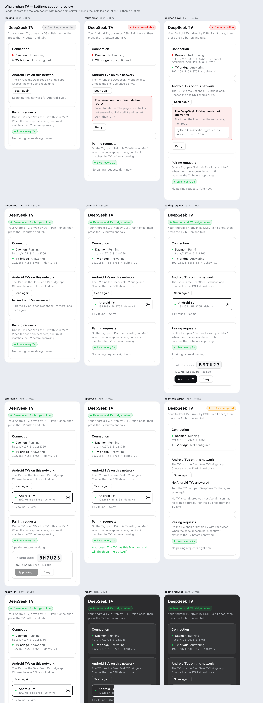

# Whale-chan TV — DSH settings pane

A DSH client plugin with a **settings section** shaped like *Mobile access*:
it scans the LAN for Android TVs running the Whale-chan APK, lets you pick one,
and generates the pairing QR the TV's pairing screen accepts.



## What it does

- `GET /whale-chan/status` → daemon state (host half proxies `host/whale_voice.py`)
- `GET /whale-chan/devices` → LAN scan (TCP probe of `:8765` on the /24 + known TV)
- `POST /whale-chan/pair/new` → pairing id, 6-char code and a QR PNG
- `GET /whale-chan/pair/status?id=` → waits for approval

The pane covers four phases — loading, daemon-down (with the next command to
run), no TVs found, and ready — and a pairing panel that polls until approved.
Copy is registered as `{ en, zh }`; the component reads the host's bound `t`.
It uses only `react` + inline `--dsw-alias-*` tokens, intrinsic flex wrapping so
it fits the 340px sidebar, and native buttons/radiogroup semantics.

## Build

```bash
cd plugin/ui
npm install
node build.mjs                 # lib/client.js (ModuleLoader bundle)
node tools/preview.mjs         # docs/screenshots/pane-preview.html
```

## Install into DSH

The package needs to be resolvable from the profile that boots the web UI
(`desktop` in this setup). Copy the folder into the profile's node_modules (or
add it as a `file:` dependency) and add the same `- insert:` row that
`cordis.patch.yml` carries, then restart DSH. Until then the pane is not drawn —
this is the "manifest seam" called out by the house plugin rule: no
`dsh.bundle.patch` / `dsh.client`, no routes and no pane, and every suite still
passes.

## Verified

- bundle parses (`new vm.Script(src)`)
- all five phases render from the real component via `react-dom/server`
  (`docs/screenshots/pane-preview.png`)
- host proxy code exercised against the live daemon (`/discover` returns the
  onn 4K Pro in 1.8 s)

Not yet verified: composition inside a booted DSH web profile (requires the
package install above + a restart).
