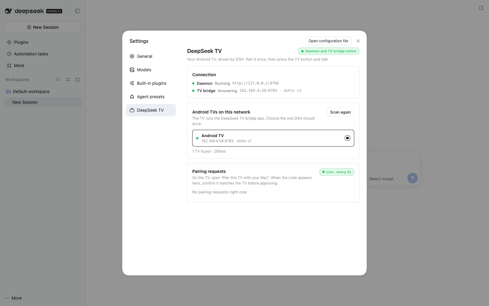
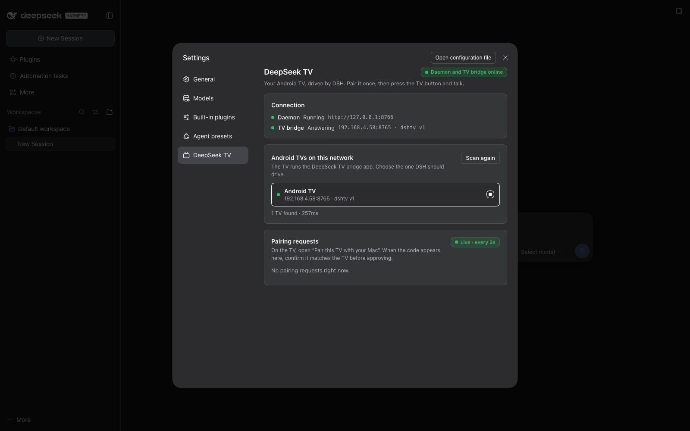

# DeepSeek TV — DSH settings pane

A DSH client plugin with a **settings section** shaped like the house ones:
it tells you honestly whether the voice daemon and the TV bridge are up, shows
the Android TVs the pane can find, and — the new capability — lets you
**approve a TV pairing request from inside DSH** instead of reaching for a
phone.

Live in a booted DSH web profile (light and dark, Appearance → Light/Dark):




All phases rendered from the real component at the pane's narrow width and the
settings modal's content width: [pane preview](docs/screenshots/pane-preview.png)
(12 cases) and [modal-width preview](docs/screenshots/pane-preview-modal.png)
(760px, light + dark). Approved state: [pane-live-approved.png](docs/screenshots/pane-live-approved.png).

## What it does

- **Connection** card: daemon reachability + TV bridge `/ping`, derived from the
  real `GET /whale-chan/status` answer (separate rows, so "daemon up, TV bridge
  down" is stated honestly instead of one misleading chip).
- **Android TVs on this network**: the configured TV from `host/config.json`
  first, then a bounded `/24` TCP sweep of port 8765 (~260 ms for 253
  candidates), each live hit confirmed with `GET /ping`.
- **Pairing requests**: polls `GET /whale-chan/pending` every 2 s, shows the
  6-character code in tracked monospace, the TV's address and age, and
  **Approve TV** / **Deny** buttons. Approving flips the daemon's
  `GET /pair/status` to `approved:true` and hands the TV its config — verified
  end-to-end from this pane.
- Four honest phases with their own copy: `loading`, `route error` (host half
  missing), `daemon down` (with the exact start command), `empty` (no TVs), plus
  `ready`; pairing-request state is independent, so approving works even when
  no TV was discovered.

Copy is registered as `{ en, zh }` and read through the host's bound `t` prop.
The pane uses only `--dsw-alias-*` / `--dsw-font-*` tokens (no colours of its
own), inline styles, intrinsic wrapping (340 px sidebar and 760 px modal,
light and dark), a named `radiogroup` for device rows, `role="status"`
`aria-live` regions for polling/approval, and real `<button type="button">`
elements with the house focus ring.

## Host routes (same origin as the GUI)

Registered with `ctx.webServer.register({ kind: 'exact', path, handler })` inside
`ctx.effect(...)`; every handler answers JSON and never throws. The daemon token
stays in the host process — it is never sent to the browser (`pair/status`
config is stripped to `hasToken`).

| Route | Verified response (live daemon) |
| --- | --- |
| `GET /whale-chan/status` | `{"ok":true,"daemon":{"reachable":true,"url":"http://127.0.0.1:8766","sessionId":"…","tv":{…}},"token":{"present":true},"target":{"host":"192.168.4.58","port":8765},"bridge":{"alive":true,"host":"192.168.4.58","port":8765,"ok":true,"app":"dshtv","version":1,"ms":9}}` |
| `GET /whale-chan/devices` | `{"ok":true,"devices":[{"host":"192.168.4.58","port":8765,"alive":true,"model":null,"app":"dshtv","version":1}],"scanned":{"mode":"configured+sweep","candidates":253,"answered":0,"tookMs":260}}` |
| `GET /whale-chan/pending` | `{"ok":true,"pending":[{"id":"…","code":"QSYBBE","createdAt":1794262334758,"ageSeconds":0,"host":"192.168.4.57"}],"daemon":true}` |
| `POST /whale-chan/pair/approve` `{id}` | `{"ok":true,"approved":true,"id":"…"}` (and the daemon's `/pair/status` then returns `approved:true` + config) |
| `POST /whale-chan/pair/deny` `{id}` | `{"ok":true,"denied":true,"id":"…"}` |
| `POST /whale-chan/pair/new` | `{"ok":true,"daemon":true,"id":"…","code":"…","url":"http://192.168.4.57:8766/pair?id=…","qr":"iVBORw0…","expiresIn":300}` |
| `GET /whale-chan/pair/status?id=` | compatibility proxy; token stripped from the returned config |

Errors are JSON too: `400` missing `id`, `405` wrong method, `404/502` expired
or daemon unreachable. Daemon endpoints used: `GET /health`,
`GET /pair/pending`, `POST /pair/approve` (JSON or form), `POST /pair/deny`,
`GET /pair/new`, `GET /pair/status`.

The daemon's `/pair/new` QR is rendered without Pillow: `host/whale_voice.py`
takes `qrcode`'s module matrix and writes a 328×328 8-bit greyscale PNG
(IHDR/IDAT/IEND, zlib, filter-0 scanlines) with the standard library only.

## Build

```bash
cd plugin/ui
npm install
node build.mjs          # lib/client.js (~21 kB module-loader bundle)
node tools/verify.mjs   # bundle parses, copy coverage, phases, house tokens
node tools/verify-host.mjs   # mounts the host half, real HTTP to the live daemon
node tools/preview.mjs --png # docs/screenshots/pane-preview*.png
```

## Install into DSH

```bash
./plugin/install-ui.sh desktop          # link (default; later builds are picked up)
./plugin/install-ui.sh desktop --copy   # frozen copy instead of a symlink
./plugin/install-ui.sh desktop --dry-run
```

The script (a) makes `plugin/ui` resolvable as
`~/.dsh/profiles/<profile>/node_modules/dsh-whale-chan-tv`, (b) appends this
loader row to the profile's `cordis.patch.yml` once (backup alongside, handles a
default `[]` patch, safe to re-run):

```yaml
- insert:
    - id: dsh-whale-chan-tv
      name: dsh-whale-chan-tv
```

then prints the restart steps. **Restart DSH** (quit/reopen the desktop app, or
restart the `dsh --profile <profile>` web host), open **Settings → DeepSeek TV
TV**. Both halves need the restart: the client bundle is composed during boot and
the host routes are registered when the plugin fiber mounts.

**Link vs copy, and how the host half finds the repo.** The host half needs the
repo's `.auth/whale.token` and `host/config.json`. A link install is a symlink
into the repo, so Node resolves the realpath and the derived path works. A
`--copy` install lives under `<profile>/node_modules/…` with no path back to the
repo, so `install-ui.sh --copy` writes a small `repo-path.txt` marker inside the
copy (the absolute repo path) and the host half reads it before falling back to
the derived path. Switching back with a link install removes the marker with the
copied directory. If the repo moves, re-run the installer (or set `WHALE_REPO`);
`GET /whale-chan/status` reports `repo.found`, the paths it looked in, and an
explicit error instead of silently reporting an empty token.

Manual fallback: symlink/copy `plugin/ui` to
`<profile>/node_modules/dsh-whale-chan-tv`, add the YAML row above, restart. For a
manual copy, drop a `repo-path.txt` containing the repo path next to
`package.json` (or set `WHALE_REPO`).

Uninstall: remove the symlink/copy and the `- insert:` row (restore the backup
if you prefer), restart DSH.

## Verified

- Host routes above exercised by `tools/verify-host.mjs` with a stub cordis
  context against the **live** daemon: 11 responses, all assertions pass,
  dispose removes the routes, the token never appears in a browser response.
- Pane rendered from the real component for every phase at 340 px and 760 px,
  light and dark (`react-dom/server` → PNG inspected); `props.t` proof: a marker
  translator appears in the output and the English fallback does not.
- **Live in a booted DSH web profile** (isolated `web` profile, light and dark):
  the section mounts, the daemon/TV bridge rows and device row are real, and a
  TV-initiated pairing request appeared and was **approved from the pane** —
  `GET /pair/status` on the daemon flipped to `approved:true` with the TV config.
- `install-ui.sh`: run against `/tmp` fixtures — symlink and `--copy` modes,
  `[]` and non-empty patches, re-run idempotency, `--dry-run` writes nothing
  (including no marker), link↔copy switching (marker written on copy, removed
  when a link replaces it), invalid/missing profile errors.
- **Copy install resolves the repo via the marker**: mounting the copied
  `lib/index.js` with a stub ctx gives `repo:{found:true,source:"marker"}`,
  `token.present:true`, the daemon reachable and the bridge target parsed; a
  copy without a marker (or a stale one) reports `repo.found:false` with the
  paths it looked in and `token.present:false` / daemon `unauthorized` — never a
  silent empty token. `WHALE_REPO` still wins over both.

## Not verified / limits

- The 340 px layout is a render check, not a live observation: the Settings
  modal gives this section ~560 px of content width; the preview covers both.
- Chinese copy is proven to render via the `zh` dictionary, but the isolated
  profile has no language switch, so no live zh screenshot.
- Approving needs the daemon up (it holds the pairing sessions); the pane says
  so and gives the start command instead of pretending.
